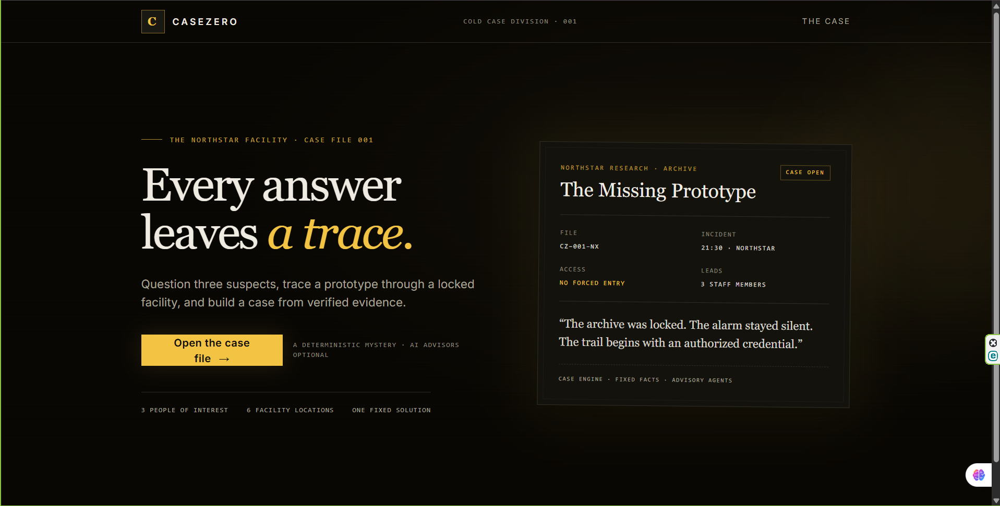
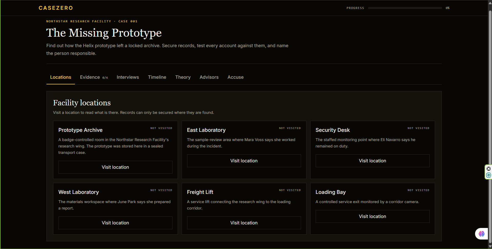

# CaseZero

> Built in Jac for AI Hackathon 2026 organized by Jaseci Labs, University of Moratuwa.

**Check out our build:** [CaseZero](https://preview-jac-sbx-8c7ec9a8d4054ac388130f82f10d0bd1.jachammer.app)

CaseZero is a detective-noir mystery game built entirely in Jac. The case is *The Missing Prototype*: visit locations, secure records, interview three suspects, compare statements against evidence, build theories, and file an accusation. The case engine decides the verdict. Four advisor agents (Lead Detective, Suspect Interviewer, Evidence Analyst, Devil's Advocate) work on rules by default and can use Gemini when `GEMINI_API_KEY` is set on the server.

## Screenshots





## How to play

You are the lead investigator. A prototype called Helix has vanished from a locked archive at the Northstar Research Facility, and nobody saw it leave. Your job is to work out what happened and accuse the right person, using records rather than hunches.

1. **Start the case.** Open the app, read the briefing, and press **Begin investigation**.
2. **Visit locations.** In the **Locations** tab, visit a place to read what is there. Records can only be secured at the place where they are found, so visit first, then press **Secure**.
3. **Study your evidence.** The **Evidence** tab shows each record you have secured, plus every statement people have given you. Statements stay unverified until a record backs them up.
4. **Interview the suspects.** In **Interviews**, choose a suspect and ask a question or pick one of the prompts. Tick a secured record under *Present evidence* to confront them with it. Their story can change when you do.
5. **Spot contradictions.** When a statement disagrees with a record, or with something the same person said earlier, the game logs it automatically. Check the **Timeline** tab to see contradictions, open leads, and which accounts agree with each other.
6. **Open the timeline.** In **Timeline**, press *Open official timeline*. Records are placed in order, claims are marked as claims, and two accounts that agree are marked as corroborated.
7. **Build a theory.** In **Theory**, write your explanation and tick the records that support it. The Devil's Advocate will challenge it with the strongest alternative.
8. **Ask your advisors.** In **Advisors**, ask the Lead Detective what to do next or ask the Evidence Analyst what your records actually prove.
9. **Make your accusation.** In **Accuse**, choose a suspect, explain your reasoning, and cite your records. The case engine will only hear an accusation backed by the two system logs. A wrong accusation keeps the case open so you can keep investigating. A correct one closes the case with the full explanation and your score.
10. **Play again.** Press **Open a new investigation** on the result screen to start over.

**Tips**

- Records beat statements. Trust what a log shows over what a person says.
- Motive is not opportunity. A reason to want something gone does not show who had access.
- Not every contradiction points to the culprit. Some are honest mistakes, so test each one against your records.
- Show suspects your evidence. Some answers only change when you do.
- Watch the progress bar at the top. It tracks records secured, suspects heard, key contradictions found, and leads resolved. It never reveals who is guilty.

## Team

| Name | GitHub |
|---|---|
| **Nisila Dinod** | [@itznisila](https://github.com/itznisila) |
| **Hesandu Ruwanpathirana** | [@Hesandu-Ruwanpathirana](https://github.com/Hesandu-Ruwanpathirana) |
| **Dulin Wataraka** | [@DulinWataraka](https://github.com/DulinWataraka) |

## Status

Playable end to end. Sessions are held in memory, so they reset when the server restarts. Advisors run on built-in rules; the optional Gemini phrasing in `services/llmBridge.jac` is currently a stub.

## Current architecture

- `main.jac` imports the global stylesheet, registers the server endpoints, and exports the single-page `app()` entry point with its routes (`/`, `/briefing`, `/suspects/:session_id`, `/case/:session_id`).
- `components/InvestigationRoom.jac` owns game state and calls the server; each tab has its own panel (`LocationsPanel`, `EvidencePanel`, `InterviewPanel`, `TimelinePanel`, `TheoryPanel`, `AdvisorsPanel`, `AccusationPanel`, `VerdictPanel`).
- `lib/` holds the fixed case data and authored knowledge (`missing_prototype_case.jac`, `case_knowledge.jac`).
- `services/caseManager.jac` handles sessions and the rules for each action; `services/caseLogic.jac` holds deterministic interview, contradiction, timeline and progress logic; `services/advisors.jac` holds the four advisors; `services/gameApi.jac` is the server API the screens call and never sends hidden case data.
- `components/ui/` contains Jac shadcn components. Treat these as managed UI primitives: import and compose them; do not hand-edit them.
- `styles/global.css` provides the Tailwind/shadcn theme imported by `main.jac`.
- `lib/utils.jac` contains the shadcn class-name helper.
- `services/caseService.jac`, `services/caseAgents.jac` and `components/CaseZeroInvestigation.jac` are earlier starter files that the game no longer uses.
- `frontend.cl.jac` is JacBuilder template splash/scaffold code, not the active entry point.
- `jac.toml` declares the web-app entry, dependencies, Tailwind Vite setup, theme, and app metadata.
- `dist/` and `.jac/` are generated output; edit source files instead.

The project uses Jac 0.34.23. Jac infers client placement for JSX-bearing `.jac` components. In `main.jac`, the global CSS import is a string-path import and local Jac modules use dotted imports. The single-page entry is `def:pub app() -> JsxElement`.

## Development workflow

Use the project root as the working directory.

```bash
jac install
jac check main.jac
jac start --dev main.jac
```

`jac install` installs the dependencies declared in `jac.toml`. `jac check main.jac` checks the application entry and its imported Jac code. `jac start --dev main.jac` starts the local development server; open the application URL it reports.

In JacHammer, the platform owns the preview process. Use the IDE's managed Preview and its displayed URL; do not start a competing server. Client edits are picked up by the preview's development workflow. If investigating a local compiler/server failure, `cat .jac-server.log` may show diagnostics when that log exists.

Before writing or editing Jac, consult the release-matched guides bundled with the CLI. Useful commands include `jac guide`, `jac guide jac-core-cheatsheet`, `jac guide jac-types`, and `jac guide <guide-name>`. Jac uses Python-like control flow with braces and semicolon-terminated statements; JSX is written in `.jac` files, not authored as separate JavaScript/TypeScript source. Use Jac's typed event handlers and state fields in client components, and always `await` client-to-server RPC calls when such calls are introduced.

## Security and data handling

- Never commit credentials, API keys, access tokens, or real case data. `.env` and `.env.*` are ignored; keep only non-secret examples in `.env.example`.
- In JacHammer, configure future provider credentials through the IDE's Environment settings and ask the project owner to supply their own key. Do not assume a key is available. For local development, `.env.example` documents the optional variable names only; `.env` and `.env.*` are ignored and must never contain committed values.
- If a future approved stage adds AI, keep provider credentials on the Jac server and access them only through server-side configuration such as the `jac.toml` `${GEMINI_API_KEY:-}` interpolation. Never use `VITE_`-prefixed secret names, import secrets into client modules, return them from endpoints, or embed them in browser-visible configuration. Restart the managed preview after changing environment settings if required for the new values to load.
- The advisors work without any key. Gemini phrasing is optional and, in the current build, switched off (`services/llmBridge.jac` is a stub that returns the rules-based answer).
- Validate and bound user-provided values at the server boundary when future endpoints are introduced. Keep authorization checks server-side; do not treat client-side visibility as access control.
- Use fictional identities and evidence. Do not put personal or confidential information in logs, prompts, fixtures, or screenshots.
- Do not render untrusted strings as raw HTML. Preserve framework escaping and avoid logging secrets.

## Testing expectations

For each change, run `jac check main.jac` and use the managed Preview to check the affected page at desktop and phone widths. Exercise the changed user interaction once and inspect visible error states. For changes involving an endpoint, also verify the client/server contract and test the actual flow through Preview; add focused Jac tests when testable behavior is introduced. Do not claim functionality that has not been verified. Generated output under `dist/` is not a substitute for testing source.

## Incremental development and commits

Develop one approved stage at a time. Keep each change focused, check the diff before committing, and avoid mixing documentation, gameplay, and infrastructure changes without a reason. A commit should leave the app checkable and the preview usable; commit messages should describe the completed change, for example `docs: define CaseZero architecture and development workflow`. This workspace may be opened without Git metadata; if Git is unavailable, report that limitation instead of claiming a diff or commit was produced.

## 30-stage roadmap

This is the original planning outline. The hackathon build delivers the playable core (see Status above); later stages such as persistence, Gemini phrasing, and expanded tests remain future work.

1. CaseZero landing page (complete).
2. Architecture and development documentation (current stage).
3. Investigation entry and case briefing.
4. Case-file domain model and deterministic case data.
5. Evidence board and clue inspection.
6. Evidence collection state and persistence design.
7. Suspect profiles and access rules.
8. Interview interface.
9. Deterministic interview response rules.
10. Evidence-aware interview context.
11. Contradiction and timeline comparison.
12. Investigator notes.
13. Lead detective guidance.
14. Accusation flow.
15. Evidence-backed case resolution.
16. Progress and case completion feedback.
17. Accessible navigation and keyboard review.
18. Responsive investigation workspace.
19. Loading, empty, and error-state review.
20. Server-side input validation and permission checks.
21. Automated tests for case rules.
22. Endpoint and client-contract tests.
23. Optional byLLM interview enhancement behind deterministic rules.
24. Configure provider secrets through environment settings.
25. AI output validation and safe fallback behavior.
26. Agent roles and bounded investigation tools.
27. Agent collaboration and evidence citations.
28. Replayable case sessions and persistence hardening.
29. End-to-end QA, security review, and performance pass.
30. Release documentation and approved deployment preparation.


## Troubleshooting
- **My game progress disappeared:** sessions are held in memory, so they reset whenever the server restarts. This is expected.
- **Do I need an API key?** No. The advisors run on built-in rules. The optional Gemini phrasing is currently switched off.
- **Something looks broken after an edit:** run `jac check main.jac` first, as it checks the app entry and the Jac code it imports.
- **Changes in `dist/` don't stick:** `dist/` is generated output, so edit the source `.jac` files instead.